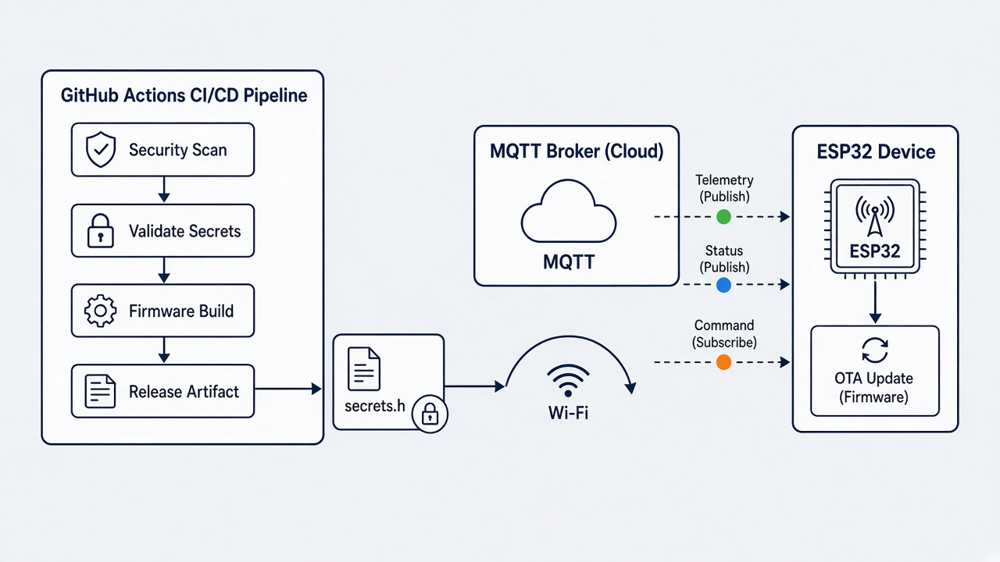
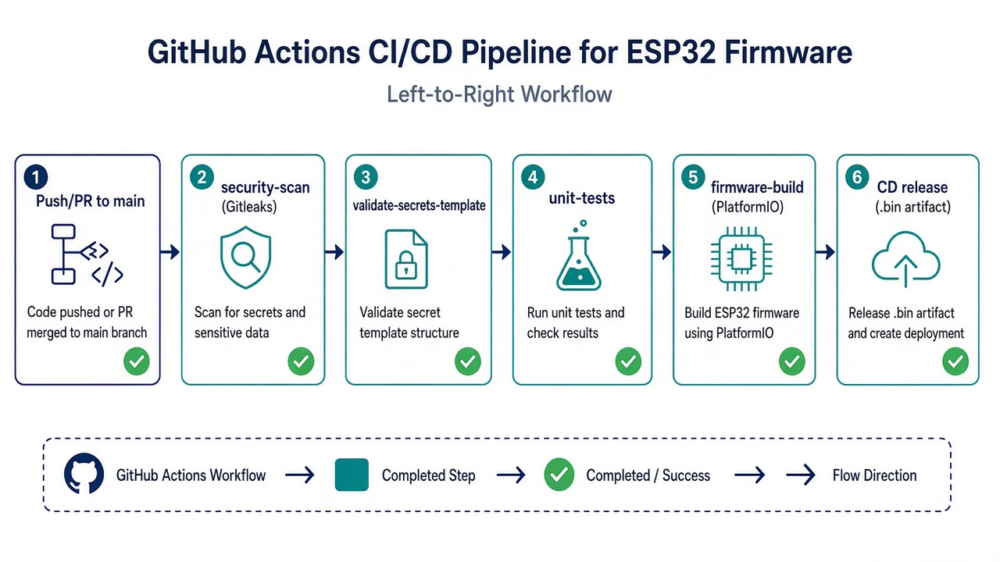

# CI/CD — ESP32 Firmware de Referência

## Visão geral



O pipeline cobre segurança, validação de secrets, testes unitários, build do
firmware e publicação de artefatos.



## Workflows

| Workflow | Arquivo | Gatilho | Função |
|----------|---------|---------|--------|
| **CI** | `.github/workflows/ci.yml` | `push` / `pull_request` em `main` | Qualidade e segurança |
| **CD** | `.github/workflows/cd.yml` | tag `v*` ou `workflow_dispatch` | Release do `.bin` |

### Jobs do CI

1. **`security-scan`** — Gitleaks (histórico completo).
2. **`validate-secrets-template`** — garante que `src/secrets.h` **não** está
   versionado, está no `.gitignore` e que `secrets.example.h` existe.
3. **`unit-tests`** — pytest em `tests/` (helper de secrets).
4. **`firmware-build`** — `pio run` com PlatformIO pinned (`requirements-dev.lock`)
   e upload do `firmware.bin` / `.elf` como artifact (14 dias).

### Jobs do CD

1. Compila o firmware com as mesmas dependências verificadas.
2. Gera `dist/esp32dev-firmware.bin`, `.elf` e `SHA256SUMS.txt`.
3. Em tags `v*`, cria GitHub Release com os binários.
4. Em `workflow_dispatch`, opcionalmente cria release `manual-<run_number>`.

## Como rodar localmente

```bash
# Testes
python -m pip install pytest
python -m pytest tests -v

# Build (gera secrets.h a partir do template na 1ª vez)
pio run
```

## Proteção da branch `main`

A `main` deve exigir PR + checks obrigatórios. Com `gh` autenticado (admin):

```bash
chmod +x scripts/protect-main-branch.sh
./scripts/protect-main-branch.sh
```

Isso cria um **ruleset** ativo em `main` exigindo:

- PR com pelo menos 1 aprovação
- resolution de threads de review
- status checks: `security-scan`, `validate-secrets-template`, `unit-tests`, `firmware-build`
- bloqueio de force-push e deleção da branch

Alternativa pela UI: **Settings → Rules → Rulesets → New branch ruleset**.

## Secrets do GitHub Actions

| Secret | Uso |
|--------|-----|
| `GITHUB_TOKEN` | Automático — Gitleaks, artifacts e releases |

Nenhuma credencial de Wi-Fi/MQTT deve existir no repositório ou nos workflows.
Credenciais de dispositivo ficam só em `src/secrets.h` local (fora do git).
