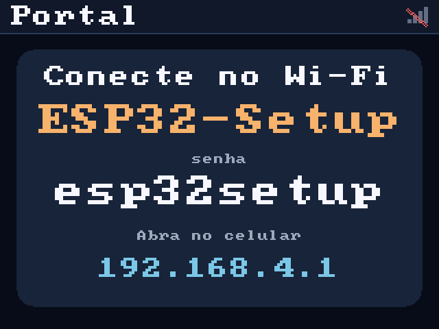
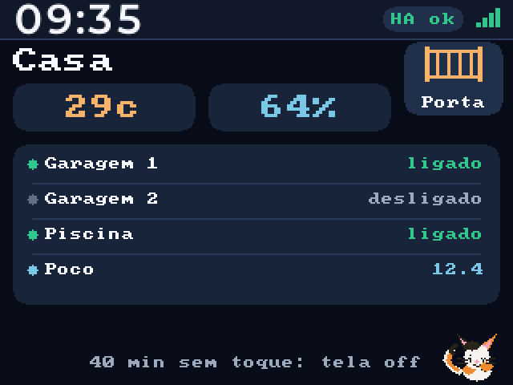
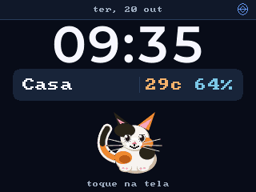
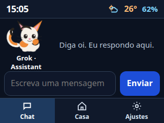
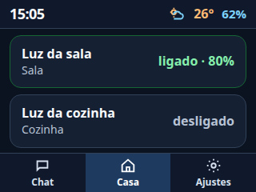

# Guia do firmware ESP32 + CYD

O que o firmware faz, como as telas se comportam e como ligar o painel amarelo
(Cheap Yellow Display 2.8") a um Home Assistant na rede local.

## O que é

Firmware para **ESP32** (ESP-IDF 5.3.2) que:

1. Entra na rede Wi-Fi salva ou sobe o portal `ESP32-Setup` no primeiro uso.
2. Serve um app web no celular (chat, Casa, Ajustes, **Tela do CYD**, OTA).
3. No **CYD 2.8"** (ESP32-2432S028, ILI9341 + XPT2046) desenha relógio, clima,
   dispositivos, câmera e alertas.

Placa alvo do painel: **só a amarela de 2.8"**. A de 3.5" usa outro controlador
e não acende com esta imagem.

## Telas do painel

### Splash

Na subida o painel mostra um gato calico ditherizado (vários quadros) e em
seguida a tela de observação ou o portal.

### Portal (sem Wi-Fi de casa)

Enquanto a placa não tem IP de estação, o painel mostra como conectar o celular:



1. Entre no Wi-Fi `ESP32-Setup`, senha `esp32setup`.
2. Abra `http://192.168.4.1`.
3. Salve a rede de casa e, no onboarding, o Home Assistant.

### Observação (conectado ao HA)

Depois que a estação ganha IP, o firmware manda um `POST /api/template` pequeno
ao HA (não baixa mais o `/api/states` inteiro) e monta a tela:



- Hora (Montserrat, 24 h por padrão) e status.
- Lugar (Casa), temperatura e umidade quando o HA tem `weather` ou sensores
  de temperatura e umidade.
- Até **cinco** linhas. Cada item da lista pode ser só a entidade
  (`switch.casa_aracaju_piscina`) ou `entidade=Rótulo`
  (`switch.carros_switch_1=Garagem 1`). O rótulo fica com no máximo 17
  caracteres.
- Padrão de fábrica: `switch.carros_switch_1=Garagem 1`,
  `switch.carros_switch_2=Garagem 2`, `switch.casa_aracaju_piscina=Piscina`,
  `switch.casa_ewelink_poco=Poco`. Vale quando a NVS ainda não tem `c_ents`.
  Se a opção de ração estiver ligada, a última linha mostra as porções de hoje
  (Spock, Kirk, Gatas) lidas de
  `sensor.alimentacao_spock_hoje`, `sensor.alimentacao_kirk_hoje` e
  `sensor.alimentacao_gatas_hoje`.
- Botão **Porta** (canto superior direito): abre a câmera rápida
  (padrão `camera.frigate_frente_direita`). O rótulo e o ícone (portão ou
  câmera) mudam em Ajustes.
- Selo de alertas no topo, quando há alertas ou atualizações do HA.

Estados que aparecem no lugar de um spinner infinito:

| Status | Significado |
|--------|-------------|
| `HA ok` | O template respondeu 200 |
| `aguardando` | Ainda não houve resposta nesta subida |
| `sem hub` | Nenhum endereço de HA salvo |
| `sem token` | Falta o token longo |
| `token ruim` | O HA respondeu 401 |
| `offline` | Sem resposta, ou outro código HTTP |
| `hub nao HA` | O hub salvo não é do tipo Home Assistant |
| `sem mem` | Sem heap para o pedido |

### Câmera

O visor pede ao HA `GET /api/camera_proxy/<entidade>?width=320&height=240` e
desenha o JPEG com o decodificador da ROM (TJpgDec). Imagens mais largas que
640 px são reduzidas.

Duas formas de abrir:

- **Campainha.** O HA chama `POST /camera` (pacote `cyd_camera`). A câmera
  padrão de fábrica é `camera.frigate_frente_esquerda`. A duração padrão é 20 s
  e o quadro atualiza a cada 1 s (os dois são ajustáveis).
- **Botão Porta.** Um toque no canto superior direito abre a câmera rápida
  pelo mesmo tempo.

### Protetor de tela

Após o tempo de descanso (padrão **30 s**) sem toque, o relógio grande toma a
tela, com data, temperatura, umidade, o gato e o **ícone de internet** no
canto:



O ícone consulta a URL salva (padrão
`http://connectivitycheck.gstatic.com/generate_204`). Arcos verdes: HTTP 200 ou
204. Arcos com um X vermelho: sem Wi-Fi ou Wi-Fi sem essa resposta. Cinza:
ainda não houve teste.

Um toque volta à observação. Após **40 minutos** sem uso a backlight apaga; um
toque acorda o painel. O gato troca de comportamento sozinho (parado, dorme,
alonga, pata, olha em volta). Dá para desligar a animação em Ajustes.

### Alertas

O HA empurra alertas com `POST /alert`. O painel guarda até 8, mostra um selo
(`! N`) na observação e no descanso e uma faixa com o mais recente.

- Toque no selo, na faixa de cima (à esquerda do botão Porta) ou na faixa de
  baixo abre a lista.
- Na lista, um toque fora do botão só fecha (“visto”) e **não** apaga.
- **LIMPAR TUDO** (faixa vermelha embaixo) apaga todos.
- Toque longo de **0,8 s** em qualquer lugar, enquanto existir alerta, também
  apaga todos.
- `duration` em segundos remove o alerta sozinho. `0` deixa até alguém limpar.
- `level`: `info` (azul), `warn` (laranja) ou `crit` (vermelho).

Acentos saem dobrados para ASCII na fonte do painel (`ã` vira `a`).

### Cores

A inversão do painel vem **desligada** (`inv=0`), que é o certo para esta
placa. A ordem **BGR** vem ligada. `POST /config` e `POST /display` só gravam
o ajuste e levantam um pedido: inversão e brilho entram na **próxima passagem**
da tarefa da tela (`display_task`). O servidor HTTP não chama
`esp_lcd_panel_invert_color()` nem o controle da backlight — fazer isso no
meio de um quadro SPI travava o painel e o HTTP depois de `POST /config`.
BGR continua valendo só depois de reiniciar. `POST /display` também aceita
`test=1` (barras de cor por 15 s).

## App web no celular

O mesmo aparelho serve a interface no navegador, na porta **80**:

| Chat | Casa |
|------|------|
|  |  |

- **Chat** manda o texto ao Assist (`/api/conversation/process`, idioma pt-BR)
  e mantém a conversa entre mensagens.
- **Casa** lista as mesmas linhas do painel.
- **Ajustes → Tela do CYD** grava em `GET /config` e `POST /config`: entidades,
  ração, câmeras, rótulo e ícone do botão, duração da campainha, intervalo do
  snapshot, brilho (5–100%), inverter cores, BGR, segundos até o descanso,
  gato, relógio 24 h, alertas e URL de teste de internet.
- **Atualizar firmware** envia `esp32-ota.bin` (ou uma URL) com a chave do
  aparelho. Ver [INSTALACAO.md](INSTALACAO.md).

## Home Assistant

### Token

No HA: perfil do usuário → **Long-Lived Access Tokens** → **Create Token**.
Cole o valor no campo **senha** do onboarding ou de Ajustes do CYD. Não use a
senha de login. O firmware guarda até **319** caracteres.

### Endereço (porta 80)

No onboarding, o exemplo é a **porta 80** do HA:

| Campo | Valor |
|-------|--------|
| Tipo | Home Assistant |
| Endereço | `http://192.168.0.10` |
| Senha | token longo |

`http://192.168.0.10` chama `http://192.168.0.10/api/template` e
`http://192.168.0.10/api/conversation/process`. Se o seu HA ainda escuta em
8123, use `http://192.168.0.10:8123`. O exemplo antigo
`homeassistant.local:8123` não é mais o padrão desta documentação: mDNS e a
porta 8123 falham em várias redes em que um reverse proxy na porta 80 já
funciona.

O poller roda a cada ~30 s enquanto houver Wi-Fi.

### Chave do aparelho

`/camera`, `/alert`, `/display`, `/ota` e `/reboot` exigem uma chave: os
**16 primeiros caracteres hexadecimais** do SHA-256 do token longo (o mesmo
salvo no CYD).

```bash
printf '%s' 'SEU_TOKEN' | sha256sum | cut -c1-16
```

Não commite o token nem a chave. No app, o campo “Chave do dispositivo” é só
para o envio de OTA feito dali; o HA guarda a chave em `secrets.yaml`.

### Pacote `cyd_camera` / `cyd_alert`

O arquivo [homeassistant/cyd.yaml](homeassistant/cyd.yaml) define:

- `rest_command.cyd_camera` — `POST http://IP_DO_CYD/camera` (porta **80** do
  painel, não a porta do HA) com `entity` e `seconds`.
- `rest_command.cyd_alert` — `POST http://IP_DO_CYD/alert` com `id`, `title`,
  `message`, `level` e `duration`.
- Uma automação de exemplo: campainha liga → abre a câmera da frente esquerda.

`secrets.yaml`:

```yaml
cyd_camera_url: "http://192.168.0.50/camera?key=SUA_CHAVE_16"
cyd_alert_url: "http://192.168.0.50/alert?key=SUA_CHAVE_16"
```

Troque `192.168.0.50` pelo IP do CYD e os `entity_id` do pacote pelos seus.
Para dispensar um alerta pelo HA: `POST /alert` com `dismiss=<id>` ou
`clear=1`.

`GET /alerts` devolve a lista em JSON. `GET /touch` devolve
`raw_x`, `raw_y`, `x`, `y` e `count` da última leitura do XPT2046.

### Reinício remoto

`POST /reboot?key=SUA_CHAVE_16` responde `{"ok":true,"reboot":true}` e
reinicia a placa cerca de **1,5 s** depois (o mesmo atraso do OTA, para a
resposta HTTP sair antes). Sem a chave a resposta é `403` com
`{"ok":false,"error":"key"}`. Serve para recuperar o painel sem desligar da
tomada.

```bash
curl -X POST "http://IP_DO_CYD/reboot?key=SUA_CHAVE_16"
```

## Tempos

| Evento | Tempo |
|--------|-------|
| Protetor (relógio grande) | 30 s sem toque (ajustável, 10–3600 s) |
| Tela off (backlight) | 40 min sem toque |
| Atualização do HA | ~30 s |
| Snapshot da câmera | 1 s (ajustável, 300–10000 ms) |
| Visor da campainha / Porta | 20 s (ajustável, 3–120 s) |
| Toque longo limpa alertas | 0,8 s |
| Confirmação do OTA (rollback) | 60 s com Wi-Fi |
| Reinício de `POST /reboot` e do OTA | ~1,5 s depois da resposta |

## Build

Veja [INSTALACAO.md](INSTALACAO.md). Resumo:

```bash
. "$HOME/esp/esp-idf/export.sh"
idf.py -B build_cyd -DSDKCONFIG_DEFAULTS="sdkconfig.defaults;sdkconfig.cyd" build
idf.py -B build_cyd -p PORTA flash monitor
```

## Pacote pronto

A pasta [`release/cyd/`](../release/cyd/) traz a imagem única
`firmware-cyd.bin` (offset `0x0`), o `esp32-ota.bin` para o `POST /ota`, os
binários separados e os scripts `flash.bat` / `flash.sh`.
